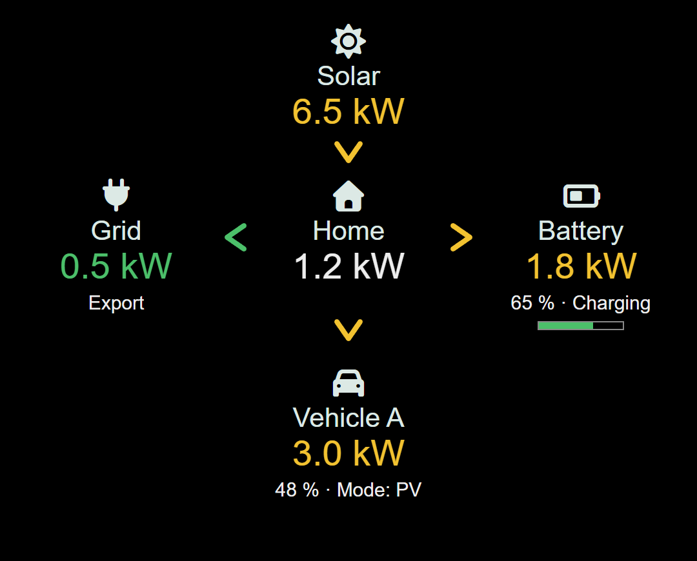

# MMM-EvccFlow

Live solar, grid, home, battery and electric vehicle energy flows from [evcc](https://evcc.io/) for [MagicMirror²](https://magicmirror.builders/).



## Features

- Clear, source-colored power readings and directional arrowheads.
- Optional battery with state-of-charge bar and multiple EV loadpoints.
- English and German; number formatting follows the MagicMirror² language.
- Configurable labels, colors, polling, visibility and animation.
- Server-side polling with timeouts; last known values remain dimmed during an outage.
- No runtime dependencies, API key or cloud subscription required by this module.

Status: maintained, first public release 1.0.0. This project is **not affiliated with evcc**.

## Requirements

- A working MagicMirror² installation with Node.js 20 or newer and the bundled Font Awesome icons.
- An evcc HTTP(S) endpoint reachable **from the MagicMirror² server** at `/api/state`.
- Tested against evcc 0.318.x during earlier development. Normalization supports direct responses and legacy `result` wrappers, aggregate values and meter arrays.

Use the Node.js version required by your MagicMirror² release. The module only reads the API;
it never changes charging modes or evcc settings. Authenticated endpoints, credentials in URLs,
redirects and self-signed TLS certificates are not supported. Keep evcc on a trusted network.

## Install

```sh
cd ~/MagicMirror/modules
git clone https://github.com/MagGyver-Ulm/MMM-EvccFlow
```

No `npm install` or build is needed. Add the module to `config/config.js`, then restart MagicMirror².

Minimal configuration (replace the placeholder):

```js
{
  module: "MMM-EvccFlow",
  position: "top_left",
  config: {
    evccUrl: "http://<evcc-host>:7070"
  }
},
```

## Configuration

All options belong inside the module's `config` object. Defaults live in `MMM-EvccFlow.js`.

| Option | Default | Meaning |
| --- | --- | --- |
| `evccUrl` | `""` | **Required.** HTTP(S) base URL; `/api/state` is appended. No credentials, query or fragment. |
| `updateInterval` | `5000` | Poll interval in milliseconds, minimum 1000. Requests never overlap. |
| `requestTimeout` | `5000` | Request timeout in milliseconds, minimum 1. |
| `flowThreshold` | `50` | Absolute watts **above** which a flow is active; values at the threshold are idle. |
| `decimal` | `"auto"` | `"auto"` uses the global MagicMirror² language; `"comma"` or `"period"` forces the decimal separator. One fractional digit. Legacy integers 0–3 keep that precision and German formatting. |
| `animate` | `false` | Gently pulse active arrows; respects reduced-motion preferences. |
| `showBattery` | `"auto"` | `"auto"` shows the battery when evcc reports battery power or SoC; `true` always shows it, `false` hides it. |
| `showLoadpoints` | `true` | Show one vehicle node per loadpoint. |
| `maxLoadpoints` | `0` | Maximum visible loadpoints, in API order; 0 means unlimited. Positive integer. |
| `showVehicleSoc` | `true` | Show known vehicle state of charge, including 0%. |
| `showChargeMode` | `true` | Show the translated charge mode below each vehicle. |
| `colors` | See below | Partial overrides for `solar`, `import`, `export`, `battery`, `idle`. |
| `batterySocThresholds` | `{ low: 20, high: 50 }` | SoC bar boundaries in percent; valid range 0–100, low ≤ high. Partial overrides allowed. |
| `labels` | `{}` | Override `solar`, `grid`, `home`, `battery`, `vehicle`; `loadpoints` is an array of per-loadpoint names. Otherwise the API vehicle title is used, with translated fallback. |

Full configuration:

```js
{
  module: "MMM-EvccFlow",
  position: "top_left",
  config: {
    evccUrl: "http://<evcc-host>:7070",
    updateInterval: 5000,
    requestTimeout: 5000,
    flowThreshold: 50,
    decimal: "auto",
    animate: false,
    showBattery: "auto",
    showLoadpoints: true,
    maxLoadpoints: 0,
    showVehicleSoc: true,
    showChargeMode: true,
    colors: {
      solar: "#f2c230",
      import: "#e5534b",
      export: "#4cc06a",
      battery: "#4cc06a",
      idle: "#666666"
    },
    batterySocThresholds: { low: 20, high: 50 },
    labels: {
      solar: "Solar",
      grid: "Grid",
      home: "Home",
      battery: "Battery",
      vehicle: "Vehicle",
      loadpoints: ["Vehicle A", "Vehicle B"]
    }
  }
},
```

Omit `labels` to keep translations and evcc vehicle titles. Unsupported languages fall back to English.

## Colors and readings

Only power values and arrows receive source colors; icons and labels stay neutral.
Power is displayed as an absolute value in kW; arrow direction and text indicate the sign.

| Flow | Default color / priority |
| --- | --- |
| Solar generation | Yellow (`solar`) |
| Grid import / export | Red (`import`) / green (`export`) |
| Battery discharge | Green (`battery`) |
| Battery charging | Red if importing, otherwise yellow |
| Vehicle charging | Red if importing; otherwise green if the battery discharges; otherwise yellow |
| Vehicle exporting | Green (`export`) |
| Missing or idle flow | Gray (`idle`), line instead of arrowhead |
| Battery SoC bar | Below low: red; low through high inclusive: yellow; above high: green |

Source priorities describe the current aggregate balance, not precise physical attribution.
Home power stays white. Unknown power shows `– kW`; unknown SoC stays blank.
The diagram is 500 px wide and adapts to its region. Vehicles use rows of up to three.

## Update

```sh
cd ~/MagicMirror/modules/MMM-EvccFlow
git pull --ff-only
```

Restart MagicMirror² after updating. No `npm install` is needed. See [CHANGELOG.md](CHANGELOG.md).
When moving from the private 0.2 series, keep your explicit `evccUrl`. Numeric `decimal`
values and the existing polling, threshold, color, animation and loadpoint options are supported.

## Troubleshooting / FAQ

- **“Set evccUrl…”**: configure the module's base URL; there is no installation-specific default.
- **“Check evccUrl…”**: use an HTTP(S) base URL without embedded authentication, query or fragment.
- **“evcc unavailable”**: check connectivity from the server, the port, HTTP status and valid JSON from `/api/state`. Errors intentionally omit URLs and raw responses from logs.
- **Dimmed values**: these are the last successful readings, not current live data. Automatic polling continues and normal display returns on recovery.
- **No battery**: `auto` hides it if no battery power or SoC is available. Use `showBattery: true` to reserve a node.
- **Too many vehicles**: set `maxLoadpoints` or disable `showLoadpoints`.
- **No arrow for a small flow**: watts at or below `flowThreshold` are intentionally idle.
- **Connection works in a browser only**: requests originate in the server's Node.js process; check its network and certificate trust. Browser CORS settings do not apply.
- **Language**: set the global MagicMirror² `language` to `"en"` or `"de"`; custom labels override translation.
- **Privacy when reporting bugs**: remove hostnames, addresses, device IDs and personal titles from configuration, logs and API excerpts.

## Development and demo

Only contributors need npm packages:

```sh
npm ci
npm run lint
npm test
```

CI runs lint and tests on Node.js 20 and 22. ESLint 9 keeps development checks compatible
with the earliest supported Node.js 20 versions; it is not loaded by end users.

For a synthetic preview, serve this directory with any static HTTP server, then open
`demo/`. For example: `npx --yes http-server .` and visit the printed local URL followed
by `/demo/`. This optional command downloads a development tool. The demo makes **no evcc requests**,
uses synthetic values and loads Font Awesome from a CDN. It is separate from the production module.
The screenshot shows only this demo module. Font Awesome Free icons by [Fonticons](https://fontawesome.com/)
are used under [CC BY 4.0](https://creativecommons.org/licenses/by/4.0/).

## Deutsch

MMM-EvccFlow zeigt die aktuellen Energieflüsse aus evcc auf MagicMirror².
Nach dem Klonen nur `evccUrl` in der `config.js` setzen und MagicMirror² neu starten.
Kein `npm install` nötig. Mit globalem `language: "de"` sind Texte und Zahlen deutsch.
Alle Optionen stehen oben; `labels` erlaubt eigene Knotennamen. Bei Ausfall bleiben
die letzten Werte abgedunkelt sichtbar. Das Projekt ist unabhängig von evcc.

## License

[MIT](LICENSE) — Copyright (c) 2026 MagGyver-Ulm. Module code, documentation and
synthetic demo data are MIT licensed; third-party icon artwork retains its license above.
